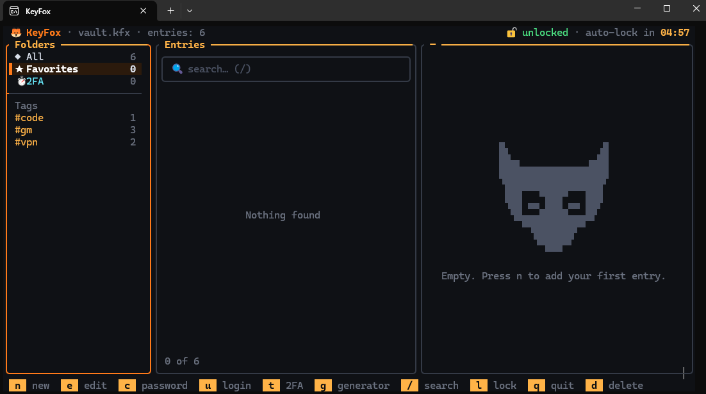
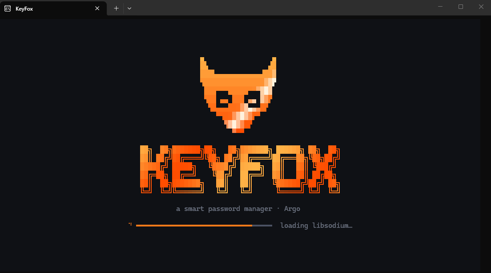
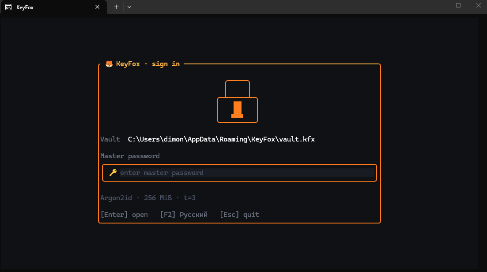
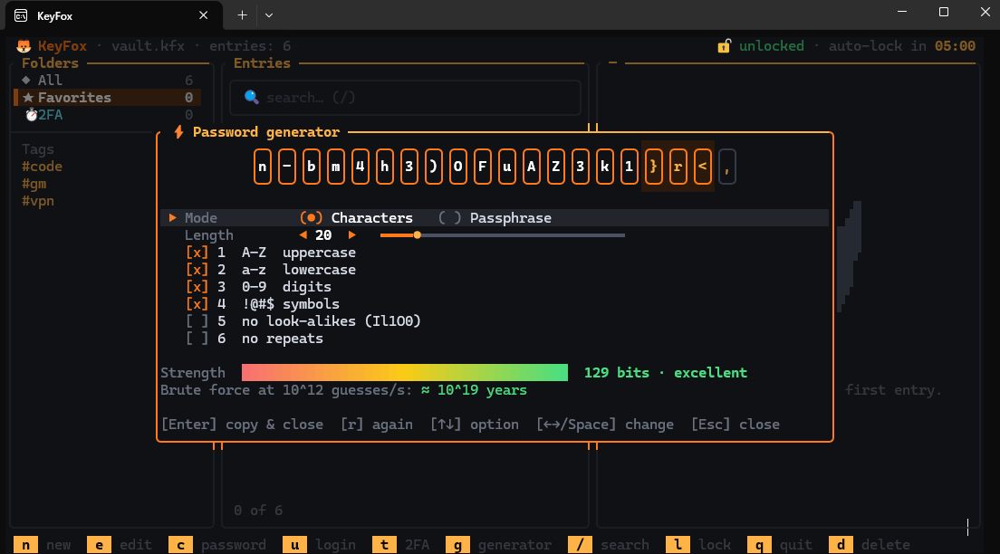

<div align="center">

# 🦊 KeyFox

**A smart, fast and secure password manager that lives in your terminal.**

Full-screen TUI · animated · single portable `.exe` · no cloud, no telemetry

[](../../releases)
[](LICENSE)




[Download](../../releases/latest) · [Build from source](BUILD.md) · [Русская версия](README.ru.md)

</div>

---

## What is KeyFox?

KeyFox keeps all your logins in **one encrypted file** on your own disk. The key is derived from your master password with **Argon2id**, and the data is sealed with **XChaCha20-Poly1305**. It uses only well-reviewed primitives (**libsodium** and **Windows CNG**) and contains no home-made cryptography.

It runs in the terminal as a polished full-screen interface with mouse support, instant search, a password generator and built-in 2FA (TOTP) codes.

## Screenshots

| Splash | Unlock |
|---|---|
|  |  |
| **Main screen** | **Password generator** |
|  |  |

## Features

- **Entries:** title, username, password, website, folder, tags, notes, favorites.
- **Folders and tags** in a sidebar; instant search across all fields (case-insensitive, Cyrillic-aware).
- **2FA codes (TOTP):** accepts a base32 secret or an `otpauth://` link (SHA1/SHA256/SHA512, 6–9 digits, any period) with a live countdown.
- **Password generator:** random characters (length 4–128, character sets, no look-alikes, no repeats) or a pronounceable passphrase. Shows exact entropy and an estimated brute-force time.
- **Strength meter** while you type.
- **Safe clipboard:** copied secrets are wiped after 15 s and are kept out of Win+V history and cloud clipboard sync.
- **Auto-lock** after 5 minutes of inactivity; keys and decrypted data are wiped from memory.
- **Change master password** with full re-encryption.
- **English and Russian** UI (English by default, press `F2` to switch). Hotkeys also work with a Russian keyboard layout.
- **Mouse support:** click to select, wheel to scroll.
- **Animations** (splash, lock/unlock, "decrypting" password reveal, slot-machine generator…). Disable with `--no-anim`.

## Install

1. Download `keyfox-v1.0.0-win-x64.zip` from the [latest release](../../releases/latest).
2. Unzip anywhere. It is a single self-contained `keyfox.exe` (static runtime, no DLLs needed).
3. Run it from **Windows Terminal** (recommended; font: Cascadia Mono).

```powershell
.\keyfox.exe
```

On first launch KeyFox offers to create a new vault at `%APPDATA%\KeyFox\vault.kfx`.

> **Windows SmartScreen** may warn about an unsigned executable. You can verify the download against the SHA-256 checksum published with the release, or [build it yourself](BUILD.md).

Minimum terminal size: **96×28** characters.

## Usage

```powershell
keyfox                              # default vault: %APPDATA%\KeyFox\vault.kfx
keyfox D:\backup\work.kfx           # another vault file
keyfox --lang ru --autolock 120 --clip 10
keyfox --kdf strong                 # Argon2id 1 GiB for a new vault
keyfox --help
```

| Option | Meaning |
|---|---|
| `path.kfx` | Vault file. If it does not exist, KeyFox offers to create it |
| `--lang en\|ru` | UI language (default `en`) |
| `--kdf interactive\|moderate\|strong` | Argon2id cost: 64 MiB / t=2, **256 MiB / t=3 (default)**, 1 GiB / t=4 |
| `--autolock N` | Lock after N seconds of inactivity (30–86400, default 300) |
| `--clip N` | Clear clipboard after N seconds (0 = never, default 15) |
| `--no-anim` | Disable animations |

### Hotkeys

| Key | Action |
|---|---|
| `↑ ↓ PgUp PgDn Home End` | Navigate |
| `← →` / `Tab` | Switch between folders and list |
| `Enter` / `c` | Copy password |
| `u` | Copy username |
| `t` | Copy 2FA code |
| `s` | Show / hide password |
| `n` / `e` | New / edit entry |
| `d` / `Del` | Delete (with confirmation) |
| `f` | Toggle favorite |
| `o` | Open website in browser |
| `g` | Password generator |
| `/` or `Ctrl+F` | Search (`Esc` clears) |
| `m` | Change master password |
| `l` | Lock |
| `F1` / `?` | Help |
| `F2` | English / Русский |
| `q` | Quit |

**Entry editor:** `Ctrl+S` save · `Tab`/`Enter` next field · `Ctrl+G` generator · `F3` show password · `F4` favorite · `Esc` cancel.
**Generator:** `↑↓` select · `←→`/`Space` change · `1`–`6` toggle sets · `r` regenerate · `c` copy · `Enter` use.

## Security

| Task | Algorithm | Why |
|---|---|---|
| Key from master password | **Argon2id v1.3**, 256 MiB, 3 passes, 128-bit salt | Memory-hard, expensive to brute-force on GPU/ASIC. A fresh salt for every vault and every password change. |
| Encryption | **XChaCha20-Poly1305 (IETF)**, 256-bit key, 192-bit nonce | Authenticated encryption: any modification of the file is detected. Random nonce on every save. |
| Header integrity | Whole 64-byte header is authenticated as associated data | KDF parameters and salt cannot be silently tampered with. |
| Length hiding | Padding to 256-byte blocks (`sodium_pad`) | File size does not reveal the exact amount of data. |
| Randomness | `randombytes_buf` / `randombytes_uniform` (OS CSPRNG) | Unbiased password generation. |
| TOTP | HMAC via Windows CNG (BCrypt) | Verified against RFC 6238 test vectors. |

Memory and OS hardening:

- Keys live in `sodium_malloc` memory (guard pages, canary, `VirtualLock` so it is never swapped out), and the page is set to `PAGE_NOACCESS` while idle.
- Decrypted data uses a wiping allocator; fields are zeroed on lock and exit.
- Atomic saves (temp file → `FlushFileBuffers` → `MoveFileEx`), previous version kept as `vault.kfx.bak`.
- No DLL loading from the current directory; ASLR, DEP, CFG, CET and terminate-on-heap-corruption are enabled.

### Vault file format (`.kfx`)

```
0   4   "KFOX"
4   2   format version (1)
6   1   KDF id   (1 = Argon2id v1.3)
7   1   AEAD id  (1 = XChaCha20-Poly1305-IETF)
8   4   Argon2 opslimit
12  4   Argon2 memlimit, KiB
16  16  salt
32  24  nonce
56  8   reserved
64  …   ciphertext + 16-byte Poly1305 tag
```

KDF parameters are range-checked on load (1–32 passes, 8 MiB–4 GiB), so a crafted file cannot hang the program.

### Limitations (honestly)

- **The master password cannot be recovered.** There is no backdoor. Forget it and the data is gone.
- A compromised machine (keylogger, admin-level malware) defeats any password manager.
- The terminal and the UI library keep text in ordinary strings. KeyFox wipes everything it can reach, but temporary copies inside FTXUI or the terminal cannot be fully controlled.
- A password placed on the clipboard can be read by other programs while it is there.
- The code has **not** been independently audited.

**Back up your `.kfx` file.** It is encrypted, so storing it in the cloud or on a USB stick is fine.

## Build from source

Short version (Developer PowerShell for VS 2022, vcpkg installed, `VCPKG_ROOT` set):

```powershell
cmake --preset release
cmake --build --preset release
ctest --preset release
```

The result is `build\release\keyfox.exe`. Full step-by-step guide for Visual Studio 2022 and VS Code, plus troubleshooting: **[BUILD.md](BUILD.md)**.

## Project layout

```
keyfox/
├── CMakeLists.txt          build, MSVC hardening flags
├── CMakePresets.json       presets: release / debug / vs2022
├── vcpkg.json              dependencies (libsodium)
├── src/
│   ├── main.cpp            argument parsing, startup
│   ├── core/               UI-independent logic (crypto, vault, TOTP, generator…)
│   ├── platform/           Win32: clipboard, console, paths
│   └── ui/                 FTXUI screens, animations, theme, ASCII art, EN/RU strings
├── tests/tests.cpp         core tests (ctest)
└── docs/screenshots/       screenshots used in this README
```

## License

[MIT](LICENSE)
